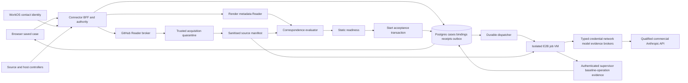
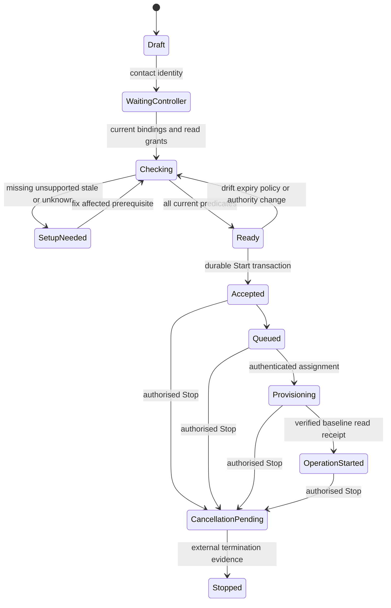

> Reviewed team baseline, 6 November 2026: this connection proposal is subject to the review addendum, implementation bridge and lifecycle atomic protocols linked from [engineering START](../START_HERE.md). Earlier programme status/owner restrictions in this frozen source are historical. No current API/implemented capability is created by this text.

# GoldGraft connection — build specification

Status: paper engineering specification, 6 November 2026. Nothing here is a deployed feature or current API unless explicitly labelled CURRENT. Proposed components/interfaces require later implementation and contract approval. Plan 1 ends at verified first sandbox operation; agent internals and Plans 2–6 remain outside scope.

## Exact boundary
One browser case: enter shop URL → establish contact identity → actual controllers authorise requester/shop/resource/recipients → read source/Render metadata → verify correspondence and preparation → review scope/Start → durable acceptance/queue → authenticated actual first baseline operation. No internal agent algorithms/orchestration, implementation, full upgrade/recovery/exit or team-document reconciliation is included. Render selected by Aditya; no service deployed or account changed.

This is a conditional buildable paper baseline. Product readiness is blocked until account/permission/custody/runtime evidence in OPEN_GATES.md is qualified. User review does not close those gates. First supported reference is a future qualified deployment of the pinned plain-PHP fixture, not arbitrary existing merchant shops.

## Architecture and trust/data movement

Tokens/signing/vault and privileged brokers stay outside untrusted VM/model. Code physically moves; scopes and processing providers are disclosed. Host grant is workspace read, with selected-service enforcement in broker and explicit controller consent; do not claim provider per-service scope. Source Reader remains provider read-only.

## Authority sequence
```mermaid
sequenceDiagram
 participant O as Owner
 participant G as Saved GoldGraft case
 participant C as Controller
 participant P as GitHub or Render
 O->>G: URL and contact sign-in
 O->>C: Scoped invitation copied by owner
 C->>P: Independent identity and resource consent
 P-->>G: Bound provider identity/resource evidence
 G->>C: Requester + shop + resources + named recipients
 C->>G: Explicit relation approval
 G->>G: Attach only authorised private inputs
 G->>G: Static inventory + match + qualified capability checks
 G-->>O: Scope, data policy and current readiness
 O->>G: Start same action identity
 G->>G: Atomic accepted receipt + outbox
 G-->>O: Accepted; waiting for worker
 G->>G: Dispatch and authenticate assigned worker
 G->>G: Verify actual baseline read evidence
 G-->>O: Sandbox work has started
```
Render return is secure key-setup continuation, not presumed OAuth. Provider role and independently verified contact identity bind the actual controller; possession of invite/email/key alone is insufficient.

## State/evidence responsibilities

These conceptual states are PROPOSED; they do not widen current Stage enums. Unknown is an observation overlay whenever authoritative outcome cannot be established, not a license to restart. Cancel-before-accept tombstone can prevent transition from Ready to Accepted. Full subsequent lifecycle is deliberately not drawn.

See [service hosting/storage and trusted receipt collection](SERVICE_AND_STORAGE_SPEC.md) for concrete control-plane services, workload identity, vault and signing boundary.

## Build by subsystem
1. [Baseline and evidence limits](../BASELINE_AND_STATUS.md), [authority](../BASELINE_AND_STATUS.md), [verified backup scope](../BASELINE_AND_STATUS.md).
2. [User/reference/runtime](SUPPORTED_FIRST_PATH.md), [Render adapter/endpoints/permissions](HOST_ADAPTER_FEASIBILITY.md).
3. [Identity/session/invitations](IDENTITY_AND_CASE_AUTHORITY.md), [Reader callback/authority](SOURCE_READER_SPEC.md).
4. [Acquisition/custody](ACQUISITION_AND_CUSTODY.md), [source-to-runtime chain](CORRESPONDENCE_SPEC.md).
5. [Processor disclosure/retention](PROCESSING_POLICY_SPEC.md), [isolated runtime/brokers](RUNTIME_AND_BROKERS_SPEC.md).
6. [Static preparation/readiness](PREFLIGHT_AND_READINESS.md), [durable Start/operation evidence](START_AND_OPERATION_EVIDENCE.md).
7. [Visible journey/copy/recovery](JOURNEY_AND_COPY_SPEC.md), [exact proposed formats/routes](INTERFACE_CHANGE_PROPOSALS.md), [component paths](COMPONENT_AND_INTERFACE_MAP.md).
8. [Future build slices](BUILD_SLICES.md), [acceptance](ACCEPTANCE_CASES.md), [fixture definitions](fixtures_spec/README.md).
9. [Decisions](TECHNICAL_DECISIONS.md), [sources](SOURCE_REGISTER.md), [release dependencies](OPEN_GATES.md), [traceability](../BASELINE_AND_STATUS.md), [review](../BASELINE_AND_STATUS.md).

No provider/current-runtime/model entitlement is inferred from a schema, fixture, successful abstract state model or signature. Current contracts are inspected anchors; proposed schemas/routes/modules are build instructions pending implementation approval, not already available interfaces.

## Provider-independent product boundary — latest clarification
[Connector extensibility specification](CONNECTOR_EXTENSIBILITY_SPEC.md) is normative for the common architecture. The diagram above illustrates the first reference only: replace GitHub/Render boxes with registered adapters, and resolve all required source/frontend/backend/data/callback nodes across hosts. No single connected host implies the complete shop is connected. Common authority/readiness/Start logic must be provider-independent.

## Fixed journey and flexible code locations — latest amendment
The permanent step is **Connect code**, with **Connect GitHub** as default and alternatives within the same saved case. Code may come from another Git provider, a maintainer-selected local/synced folder, qualified cloud files or safe host export. No code/access means controller handoff, not forced GitHub/ZIP. See [fixed journey and source routes](FIXED_JOURNEY_AND_SOURCE_ROUTES.md). This broadens the paper architecture; alternative routes remain unimplemented/unqualified and “most users” is an unmeasured target.

## Whole required code and working-site handover
[Code and environment handoff](CODE_AND_ENVIRONMENT_HANDOFF.md) specifies exactly what source, dependencies, config/state references and correspondence evidence the worker must receive, with isolated baseline/working-copy boundaries. [Programme delivery requirements](../DELIVERY_REQUIREMENTS.md) assigns actual baseline reproduction, upgrade, deployment and lasting operational handover to Plan3. Copying/test success alone cannot prove live-site identity or final success.

## Final closure authority
Plan1 is now closed as paper engineering at Aditya's request. [PLAN_1_CLOSURE.md](../BASELINE_AND_STATUS.md) records scope/evidence/reopen limits and [WP_COMPLETION_MATRIX.md](../BASELINE_AND_STATUS.md) maps all 14 packages. [CONNECTION_CONTROL_PROPOSAL.md](CONNECTION_CONTROL_PROPOSAL.md) is the canonical proposed graph/snapshot/package/readiness/acceptance/status/cancel interface; historical draft fields elsewhere are superseded where inconsistent. Product/live gates stay open; Plans2–6 have not started.
