# Start to working-site delivery — engineering specification

Status: Plan3 engineering on paper, 6 November 2026. No implementation, account change, deployment, live payment/model/worker job or agent-internal design. CURRENT means inspected existing contract; all new lifecycle states/interfaces/modules below are PROPOSED. Vendor/account/runtime qualification gates remain open.

## Scope and completion boundary
Consume the final Plan1 WorkPackage/resource graph and durable accepted action. Produce an unchanged baseline result, isolated upgraded candidate, meaningful proof/review, exact separately authorised publish/apply, actual deployment/runtime validation, state-safe recovery and successful disengagement leaving merchant systems operational. A receipt, PR, certificate, preview or running sandbox is insufficient. All examples use required declared scope, not an unqualified “all PayPal products”. Actual agent communication/planning/tools/prompts/algorithms remain Aditya's later Plan5 decisions; only work requests/results/evidence and authority responsibilities are defined now.

## First reference and supported delivery profile
Continue Plan1 pinned plain-PHP one-time-payment reference, source snapshots independent of GitHub, Render image-backed host as first qualified delivery target. Current fixture is lab input only: unauthenticated helpers, mutable base image and flat-file state need qualification before any exposure. Do not market this as safe live commerce today. Required supported flows include approved/cancelled/declined/pending, duplicate/lost response, capture/order state, refunds and authenticated duplicate/out-of-order notifications. Live historical obligations and recurring products must be inventoried; if present but unsupported, full merchant upgrade is held rather than reduced silently.

For a Git-backed source/destination, publication path selected for paper: separately consented Publisher App creates review branch/PR only after CI/host side-effect qualification. Proposed protected apply broker may merge exact reviewed PR only after separate current controller approval and provider protection requirements; this changes the old controller-only manual merge assumption and is explicitly a proposal, not initial authority. Separate Render deploy capability is acquired only for exact approved action; Reader stays read-only permanently. Agent never receives publication/merge/deploy credentials. Non-Git input has a separately authorised DirectArtifact route (private merchant-owned source bundle/registry + immutable digest deploy), not a forced GitHub migration or fictional PR; see DELIVERY_AUTOMATION_AND_AUTHORITY.md. First image-backed profile requires validated manual/API deployment of exact tested digest, no automatic production deploy from repository push. Git-backed delivery is conditional alternate needing its own trigger/control qualification, not assumed supported.

## External component graph

```mermaid
flowchart LR
 Accepted[Accepted WorkPackage] --> Baseline[Isolated unchanged baseline]
 Baseline --> Evidence[Baseline results and requirement gaps]
 Evidence --> Candidate[Writable isolated candidate]
 Candidate --> Tests[Regression domain security and mutation evidence]
 Tests --> Review[Private independent review]
 Review --> Approval[Current controller exact-result approval]
 Approval --> Publish[Qualified publication merge and deploy brokers]
 Publish --> Observe[Actual target runtime and state verification]
 Observe --> Finalise[Merchant-owned steady-state finalisation]
 Finalise --> Exit[Revoke temporary access and stop workers]
 Exit --> Success[Site still works evidence]
 Publish --> Recovery[State-aware hold cutback or repair]
 Observe --> Recovery
```

Core service/database authority and isolated execution/brokers are inherited from Plan1; actual handlers live behind shared contracts, not cross-piece imports. Gupta owns backend/runner/mechanisms; Vijay shop-domain runtime/scenarios/state compatibility; Singhal deterministic proof/report sufficiency; Singh UI/agent external integration and shared formats. Plan2 refines exact deltas after Plan4 review.

## Stage contract and ordering
1. Verify current accepted package/graph/scope/grants/custody/runtime version and collect actual baseline-read operation evidence. Lease/VM creation alone is not work started.
2. Materialise immutable BASELINE source and independent writable WORKING; build/run old twice with separate synthetic state and genuinely scoped sandbox identity. Characterise existing bugs against normative payment rules, not automatic old-code correctness.
3. Produce required rule/coverage/delta/test plan and candidate work request. Missing essential source/runtime/fixture/authority holds; no silent skipped backend/private dependency.
4. Accept candidate bytes/diff only as untrusted output. Run deterministic format/security/dependency/flow/regression checks on exact candidate and clean sandbox state, including isolated mutant variants. Bounded budget/retry; never LLM-decided permission or verdict.
5. Build private evidence/review bundle bound to baseline/candidate/artifact/tests/versions/exclusions. Critical unverified paths or failing rules prevent full approval; partial analysis may be returned labelled incomplete.
6. Acquire separate provider publication authority, qualify current push/PR/CI/preview/deploy effects, revalidate exact revision/environment/policy and issue expiring action-bound approval. Controller/provider consent is not proof of result correctness and is not reusable approval for future revisions.
7. Prepare durable merchant-controlled data/callback/runtime/registry/credentials/recovery assets under explicit apply authority, then perform protected publication/merge and separate exact-digest deployment. Every external effect has intent/identity/receipt/reconciliation; never blind retry.
8. Verify actual source/artifact/runtime/domain/backend/config plus required live-safe observations and payment/notification/order-state continuity. No real buyer charge/refund is created just to prove production without separate transaction authority. Sandbox and actual live operational evidence remain separate.
9. Finalise merchant-owned switchless or locally durable safe steady state, preserving origin adapters/refund/notification obligations. Re-run relevant qualification after cleanup candidate changes, obtain renewed exact-result approval where required, deploy final artifact and verify again.
10. Remove temporary GoldGraft workers/tokens/copies according to policy, then prove runtime/critical handlers continue after access denial/control-plane loss and actual restart under authorised qualification. Success requires no unacknowledged technical finishing task. External long-tail responsibilities retained by merchant are explicit operating obligations, not hidden incomplete migration.

Detailed stage/state/effect: STATE_AND_EFFECT_TABLE.md. Proof: BASELINE_REPRODUCTION.md and APPROVAL_AND_EVIDENCE.md. Apply: DELIVERY_AUTOMATION_AND_AUTHORITY.md / RENDER_DELIVERY_AND_STATE.md. Stop/recovery/exit: RECOVERY_AND_ROLLBACK.md / SUCCESSFUL_EXIT.md / WORKING_SITE_HANDOVER.md. Proposed interfaces: LIFECYCLE_INTERFACE_PROPOSALS.md. Implementation slices and future tests remain specifications only.

## Plan4 material-correction authority
[ATOMIC_DELIVERY_PROTOCOLS.md](ATOMIC_DELIVERY_PROTOCOLS.md) is normative for bootstrap state transfer BEFORE first destructive prerequisite change, cross-case target reservations/shared-asset cleanup, exact deployable-image build/test/private publish, IPN unverified receipt→acknowledgement→validation ordering, independent per-resource apply authority/approval-set/per-effect-slot consumption and merchant-owned post-denial exit executor. It supersedes ambiguous earlier single-controller/global consumed_at/per-run-only-lock/post-revoke-self-restart wording. All mechanisms remain paper proposals; actual qualification is open.
