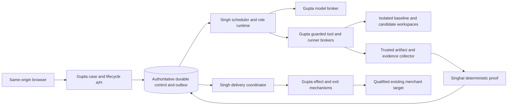

# Autonomous agent system: construction design

PROPOSED,6 November2026. No agents, processes or external calls were implemented/run by this paper work. This is the selected Python coordinator design, not adoption of historical Claude SDK/model settings.

## Anatomy and placement

In service operation the scheduler is a long-running background worker, awakened by durable committed events or due timers. It does not need an open browser. Shared GU control stores authoritative case/run/task/current generation; S3/custody services store private content-addressed artifacts. The source/model broker and runner are separate trust domains. No shop code executes inside scheduler/API/model-broker processes. The UI never talks directly to models or runners.

Existing Render control-plane/Postgres/S3/Secrets Manager/E2B processing targets remain the reviewed deployment proposal. This design adds no platform provisioning. Account/tier/region/egress/terms and supervisor qualification are still CG/PG gates. Local assembly uses explicit fake ports and synthetic files; it is not a fallback for failed service isolation.

## One bounded model/tool loop

1. Claim one current task through TaskControl with an expiring lease/fence; validate accepted work, current authority, custody expiry, inputs, output slot and reserved budget.
2. Construct context from the immutable role prompt, approved operation and policy, pinned package manifest, narrowly selected redacted source/artifact excerpts and prior validated tool observations. Mark all repository/comments/docs/provider text untrusted. No private customer rows, credential values or unbounded transcript concatenation.
3. Ask ModelBroker for one turn, with allowed tool catalog, typed completion schema, maximum tokens and deadline. Provider response is an observation. Broker receipts prove an inference call occurred, not that its result is right.
4. Parse exactly one of `tool_calls`, `final`, `blocked`. Reject extra fields, unknown tool/schema, oversized output or invalid references. A malformed response gets one schema-correction turn within the existing budget; it does not expand tools.
5. For a tool call, persist an immutable ToolInvocation before dispatch. Validate arguments and role/operation capability at runtime and again at the broker. Recheck generation, lease, resource authority and current budget before each use. Execute only the typed catalog operation, not a model-supplied URL/SQL/shell on the control plane.
6. Persist the authenticated bounded result and any artifact refs, then include its redacted observation in the next turn. A tool timeout can leave unknown effects; reconciliation precedes retry. No uncapped loop or self-issued consent.
7. A final output must validate against the task's exact schema/owner/subject. Trusted collector computes source/tree/artifact identity; runtime stages and schema-checks it. TaskControl atomically accepts output refs and advances task state only if version/lease/generation still match.
8. Scheduler unlocks dependent tasks. Independent proof and later controller approval remain separate. An agent saying “done” ends only its bounded task.

Provider session/thread history is not authoritative durable state. Resume builds context from the task checkpoint and verified artifacts. An unavailable provider receipt never becomes an invented completion.

## Task graph and exclusive writes

The fixed first programme is package verification → Surveyor → Builder → Explorer OLD/OLD_TWIN → Scribe → Architect → Grafter → Builder exact candidate image → Explorer candidate + Adversary scenarios/mutant forks → independent proof → review. Builder and Explorer perform distinct jobs: reproducible environment/driver construction versus scenario execution/capture. Scribe owns rule synthesis; Adversary owns independently derived guard tests. Architect owns plan; Grafter owns candidate edits. Proof is Singhal's deterministic service, not another creative agent.

Gardener produces only admitted task proposals. A validator rejects cycles, unknown roles/operations, unbounded counts, inputs not owned by this case or absent dependencies. Models cannot put apply/deploy/financial actions into the sandbox graph. Rework is explicit: create a new candidate attempt, invalidate dependent image/tests/review/approval refs and rerun affected checks. Never overwrite baseline or reuse prior passed tests after content/config changes.

Only one writer lease for `(case,run,candidate_workspace)` is held by Grafter. Read-only analysis may run in parallel against pinned snapshots. Mutants use individually bounded disposable forks and cannot merge into candidate. No parallel mutation of shared state. Backend owns canonical live-resource reservations across cases, not Singh's scheduler.

## Durable ownership and restart

| State | Durable owner | Restart rule |
|---|---|---|
| Acceptance, current case/run, action tombstones and generation | GU03 | Read current committed facts; no replay acceptance relaunch |
| Task DAG, task version, lease, timers, inbox/outbox and tool-intent/result refs | GU03 TaskControl mechanism; Singh policy | Claim/complete via compare-and-swap; dedupe by stable task/request keys |
| Source/package and evidence bytes | GU02 custody/trusted collector | Resolve scoped ref; check bytes/hash/expiry, never trust just a URL |
| Role loop transcript checkpoint | GU03 private task checkpoint store | Persist redacted turn/result refs, prompt/profile versions, cursor and budget; resume at last committed boundary |
| Tool effect state, provider receipts, target reservations and reconciliation | GU04/GU05 | Unknown remains fenced; a fresh scheduler cannot issue a new effect identity |
| Proof decisions | SH01–03 immutable outputs | New subject/input invalidates old result; re-fetch exact refs |

The existing ledger/tracker is useful source to reuse, but per-graft locks and daemon-thread timeouts do not supply full task/outbox/current-authority/external-effect semantics. Do not extend the old Stage/1 with lifecycle names or trust its legacy `DONE` as new completion. SI01 introduces distinct types and explicit legacy denial. GU03 implements durable mechanisms; Singh builds policy against the same typed boundary and labelled persistent fake.

After a crash before a tool intent commit: no tool dispatch is allowed. After intent commit and before known result: new owner inspects original invocation; known read-only work can retry with identical identity, but dispatch/stateful/model-spend unknowns reconcile or hold. After output commit and before event delivery: outbox redelivery is harmless; dependent task has a unique readiness key. A stale worker cannot append an accepted output even if it finishes successfully.

## Initial bounded operating policy

These are conservative engineering defaults, not throughput/cost guarantees. Keep them in versioned `policies/offline.yaml` and a separately approved service profile.

| Setting | Initial value / enforcement |
|---|---|
| Active runs per local worker |1; service initially1 per worker, quota controlled by backend |
| Parallel read-only tasks per run |2; candidate writer1; mutant execution1 |
| Admitted graph size |32 tasks initially, excluding bounded retry attempts; overflow holds |
| Model turns per task |12, tool calls per task24, in one turn≤4 validated independent reads; other calls serial |
| Invalid response repair |1 extra turn within the12, then blocked `INVALID_MODEL_OUTPUT` |
| Semantic candidate repair |2 rounds total per run; no automatic expensive-model extra round |
| Retryable read attempts |3 total with full jitter: upper delays1s then2s, maximum30s; current authority/deadline still required |
| Model turn deadline |90s; provider receipt/budget reconciliation after ambiguous timeout |
| Task deadline |10min; runner build task may use qualified30min profile, never silently extend custody |
| Lease/heartbeat |60s lease, heartbeat every15s; expiry fences old owner; external execution termination separately observed |
| Wakeups |Committed event plus due timer scan every5s; recovery scan every30s; no user dispatch |
| Stall signal |No committed progress for120s while runnable → diagnostic; no completed-work claim from heartbeat alone |
| Context cap |24,000 input tokens and4,000 output per turn, provider tokenizer checked; trim derived summaries before required evidence |
| Offline monetary budget |0; model/payment/provider network calls deny. Scripted turn fake only |
| Service budget |Required explicit per-run integer micro-USD cap + token/operation quotas, reserved atomically by broker. Missing cap or pricing evidence holds model work |

No dollar-success estimate is inferred from historical roster costs. Model profile/version selection is an evaluation task after explicit build/test authority. Cost reservation includes possible billed unknown response; a retry cannot spend an unreserved allowance. Budget exhaustion safely holds rather than lowering proof/flow requirements.

## Security, stopping and observability

Repository instructions, runtime stdout, model responses and other-agent text are untrusted data. Retrieve through case/resource ACL and bounded path allowlists; reject parent paths, symlinks, internal network/metadata targets and cross-case refs before reading. Source/docs provenance is recorded. Do not place untrusted text in the immutable role/system policy. Secret scanning is one layer; broker-side custody and no unrestricted egress remain necessary.

Stop is a backend durable intent ordered with dispatch/lease/effect locks. Scheduler stops new tasks, fences outstanding capabilities and requests runner/model cancellation. UI says cancellation pending until trusted termination and external-effect status are known. Sandbox payment effects still reconcile. After apply dispatch, Stop does not mean the shop was unchanged; delivery coordinator enters reconciliation or approved state-aware recovery. Resume requires a fresh current-authority check and explicit resumable stage; never simply replay an old Start receipt.

Record redacted case/run/task/message/invocation/effect IDs, generation/epochs, prompt/model/policy versions, tool arguments digest, artifact hashes, timing, outcome, reason code and budget reservations. Do not record chain-of-thought, secrets, raw private transcripts or customer/payment payloads in general logs. Diagnostic counters: ready/waiting tasks, lease expiries, duplicate/stale rejections, time to next committed task, unknown tools/effects, repair count, token/cost reservation/use, proof missing counts and cleanup pending. Evidence class accompanies every result: scripted/mock, actual own component offline, real model, real provider, real payment, isolation or merchant-exit qualification.

Public-system lessons and evidence limits are source-linked in the private research study. No company's reported multi-agent benchmark is treated as GoldGraft performance, and no framework is trusted to grant payment safety.
